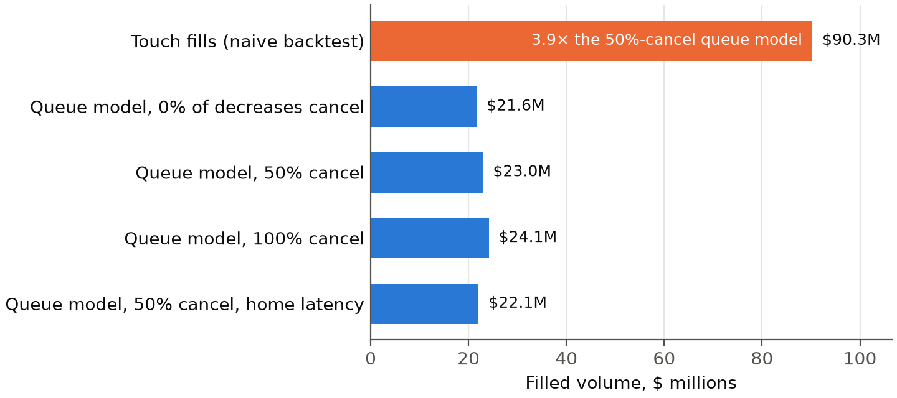
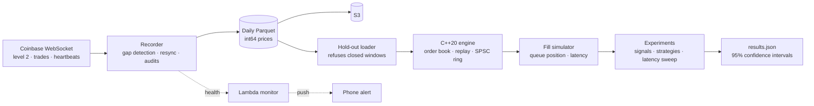
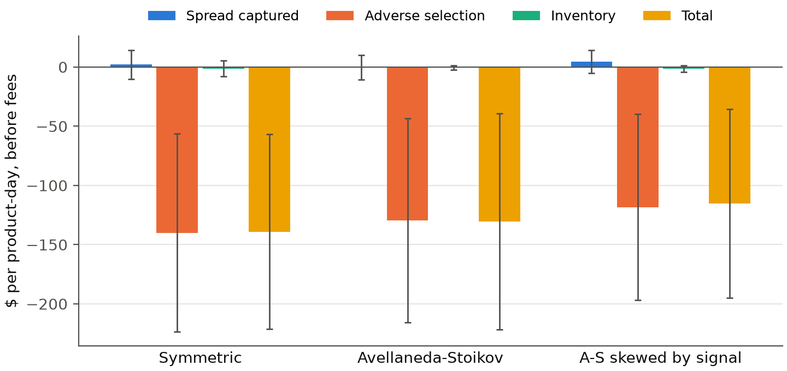
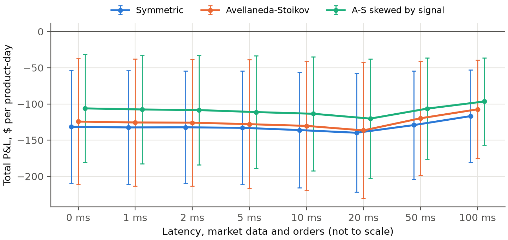
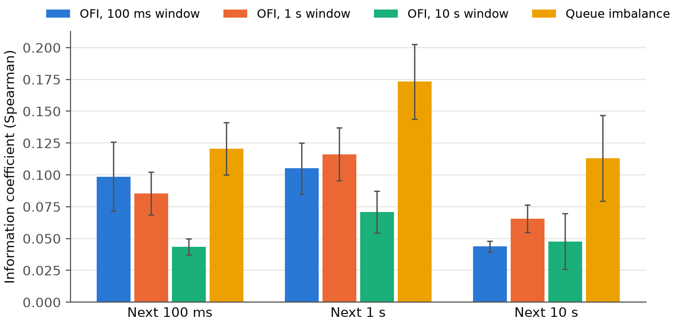
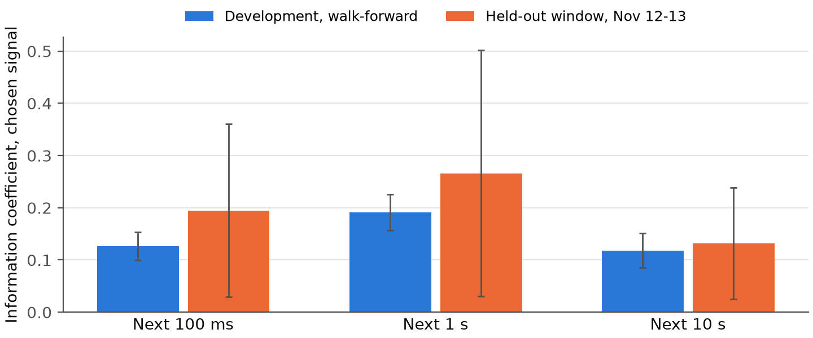
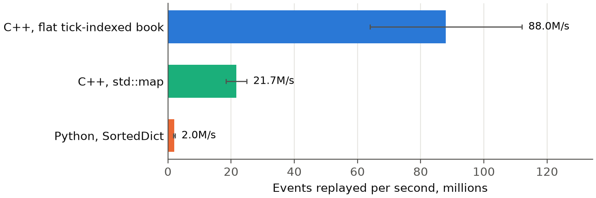

<div align="center">

# Touchstone

**How much does a naive market-making backtest lie? A queue-aware backtester built on a Coinbase order book recorded around the clock.**

[](https://github.com/CarlGergi/Touchstone/actions/workflows/ci.yml)


[](LICENSE)

<br/>



<sub>Filled dollar volume for one quoting strategy on BTC-USD and ETH-USD, <!--n:dev.days-->2026-11-06 to 2026-11-11<!--/n-->. Counting a fill whenever the price touches the quote claims <!--n:fill.ratio-->3.9×<!--/n--> the volume of the queue-position model (95% CI <!--n:fill.ratio_ci-->3.3× to 4.8×<!--/n-->).</sub>

</div>

## At a glance

| Result | Measured | Conditions |
| --- | --- | --- |
| Filled volume claimed by a touch-fill backtest | **<!--n:fill.ratio-->3.9×<!--/n-->** the queue model (95% CI <!--n:fill.ratio_ci-->3.3× to 4.8×<!--/n-->) | <!--n:dev.product_days-->12<!--/n--> development product-days, BTC-USD and ETH-USD |
| The same, on the held-out window | <!--n:holdout.fill.ratio-->3.3× (95% CI 2.1× to 3.6×)<!--/n--> | 2026-11-12 00:00 to 2026-11-13 17:59:50 UTC, evaluated once |
| Latency at which the market-making edge disappears | **<!--n:edge-->0 ms<!--/n-->**: no strategy made money even with no delay | three strategies, before fees |
| Best signal, out-of-sample information coefficient | queue imbalance, **<!--n:ic.1s-->0.191 (95% CI 0.157 to 0.226)<!--/n-->** at 1 s | walk-forward by day |
| Replay speed-up, C++ flat book over a `std::map` book | **<!--n:replay.speedup-->4.0× (95% CI 3.5× to 4.6×)<!--/n-->** | same rows, books run in alternation, so machine load hits both alike |
| Replay throughput, C++ flat book | <!--n:replay.flat_value-->88.0M<!--/n--> events/s | Apple M5 Max under load, average <!--n:bench.load-->3.6 before, 16.8 after<!--/n--> |
| Ring-buffer handoff, median | <!--n:ring.p50-->208 ns (95% CI 208 ns to 208 ns)<!--/n--> | 200,000 rows/s between two threads, same load |
| Replayed book against independent snapshots | **<!--n:audits-->1,134 / 1,134<!--/n-->** audits matched | one snapshot every 15 minutes |
| Events recorded and replayed | **<!--n:events-->237.7M<!--/n-->** | BTC-USD and ETH-USD, <!--n:dev.days-->2026-11-06 to 2026-11-11<!--/n--> |

## Overview

Backtests of passive strategies usually assume a quote is filled as soon as the market trades at its price. A real order waits behind everyone who joined the price level first, and it arrives late. Touchstone measures the difference. It records Coinbase's full level-2 book and trades around the clock on AWS, proves the replayed book against independent snapshots, and simulates fills from queue position, cancellations ahead of the order and measured network latency. On top of that it runs a signal study and three market-making strategies, chosen by walk-forward on earlier days and checked once on a held-out window that the data loader refuses to open early.

## Architecture



| Component | Technology | Why |
| --- | --- | --- |
| Recorder (`src/touchstone/recorder/`) | Python asyncio, `websockets`, Polars, Parquet | One connection per product, because Coinbase numbers messages per connection and a gap must reset only its own book. Prices are stored as integers (×1e8) so levels compare exactly. Rows are written as 30-second part files, so a crash loses at most 30 seconds. |
| Order book and replay (`engine/`) | C++20, pybind11, scikit-build-core | Replay is the inner loop of every experiment. The same replay in Python runs at <!--n:replay.python-->2.0M (95% CI 1.8M to 2.2M)<!--/n--> events/s. |
| Flat book (`flat_book.hpp`) | Tick-indexed array, three-level bitmap, `std::map` for outliers | Most updates land near the best price, so a level becomes one array write and the best price is a few bit operations. The book spans $0.01 to $139M, so far levels stay in a map. |
| Ring buffer (`ring_buffer.hpp`) | Lock-free single producer, single consumer, acquire/release | Separates a network thread from the engine thread with no locks, and measures what the handoff costs. |
| Fill simulator (`simulation.py`) | NumPy | Queue position, cancellations ahead, latency, cancel-versus-fill races and post-only rejection. |
| Research (`signals.py`, `experiments/`) | Polars, bootstrap and t intervals | Purged walk-forward by day, with signals computed from arrival time, never from exchange time. |
| Operations (`scripts/`) | EC2 (Graviton), systemd, Docker, S3, Lambda, EventBridge, AWS Budgets | Always-on capture, a phone alert within 10 minutes of a stall, and an automatic stop at $90 of spend. |

<details>
<summary><b>Recorder reference</b>: keeping the book correct, audits, files, schema, health log, commands</summary>

#### Keeping the book correct

The output's central guarantee is that replaying any recorded session reproduces the exchange's book exactly. A lost message that went unnoticed would corrupt every later price, so:

- **Gap detection.** `sequence_num` is per connection and rises by one across all channels, so each product gets its own connection and any jump counts as a loss.
- **Resync from snapshots.** A gap only says that something was lost, not what. The recorder discards the session without writing the message that exposed the gap, reconnects, and starts again from a fresh snapshot.
- **Treating doubt as loss.** An unreadable message, a server error, a silent socket, a book that stops updating while heartbeats continue, or a missing snapshot all force a resync.
- **Self-contained days.** The session is restarted at midnight UTC, so each daily file starts with a real exchange snapshot.

#### Audit snapshots

Every 15 minutes a second connection fetches a snapshot and records it as `audit_snapshot` without disturbing the main session. These give the replay engine independent checkpoints to verify the rebuilt book against.

An audit's time often falls between two stream batches, and the snapshot may already include part of the later batch. So a rebuilt book is compared with an audit like this: applying every batch up to the audit's time must match it exactly, except at levels touched by the next batch. On the live feed, all 22 audits checked held to this rule, at about 40,000 levels for BTC-USD and 19,000 for ETH-USD, and the 11 landing exactly on a batch time matched on every level.

#### Files

```text
data/
  BTC-USD/2026-11-04.parquet                    one file per product per finished day
  .spool/BTC-USD/2026-11-05/part-00000001.parquet   rows for the current day
  health/2026-11-05.jsonl                       health log
  status.json                                   current state, read by the container health check
```

A Parquet file is unreadable until its footer is written, so holding a daily file open would risk the whole day on a crash. Rows are written instead as complete part files every 30 seconds and merged once the day is over, which limits a crash to the last 30 seconds of buffered rows. The merge is atomic, and recovery on restart handles a crash at any step. `touchstone.recorder.storage.read_day` reads a day whether or not it has been merged.

#### Schema

Each row is one changed book level or one trade.

| Column | Type | Meaning |
| --- | --- | --- |
| `local_ts_ns` | Int64 | Local wall clock when the message was received |
| `server_ts_ns` | Int64 | When Coinbase's WebSocket server sent the message |
| `exchange_ts_ns` | Int64 | The matching engine's time for this level change or trade |
| `session` | Int64 | Identifies one connection; its value is the time the connection opened |
| `seq` | Int64 | `sequence_num` of the message, unique within a session |
| `event` | Enum | See below |
| `side` | Enum | `bid` or `ask`. For trades, the side of the resting (maker) order |
| `price_e8` | Int64 | Price multiplied by 1e8, which keeps it exact |
| `size_e8` | Int64 | New absolute size at the level, or traded size, multiplied by 1e8. Zero removes a level |
| `trade_id` | Int64 | Trades only |

| `event` | Meaning |
| --- | --- |
| `snapshot` | The full book at the start of a session. Replay resets its book here |
| `update` | A change to one level |
| `trade` | A trade Coinbase labelled as an update |
| `trade_snapshot` | A trade Coinbase labelled as a snapshot. These are the last 100 trades on subscribing, which can predate the session, but also occasional batches of new trades in mid-session that are delivered nowhere else |
| `audit_snapshot` | An independent book snapshot from a separate connection. Not part of the replay stream |

Rows are in arrival order. To replay, take one `session` at a time and read `snapshot` and `update` rows in file order.

#### Things to know when reading the data

- **Use both trade labels.** Filtering on `event == "trade"` silently loses real trades. Take `trade` and `trade_snapshot` together. Repeats are already removed, and trade ids rise by one per product, so `verify` can count any that are missing.
- **Sort trades by `exchange_ts_ns`.** Coinbase lists each batch newest first.
- **Keep what was known separate from what happened.** Trades are batched over 250 ms, so a trade's `local_ts_ns` can trail its `exchange_ts_ns` by that much. Anything simulating what a strategy could have known at a given moment has to use the local time, or it will see trades before they could have arrived.
- **The book is conflated at 50 ms.** See [Limitations](#limitations-and-future-work).

#### Health log

`health/YYYY-MM-DD.jsonl` holds one JSON object per line. The events are `start`, `stop`, `fatal`, `connected`, `synced`, `gap`, `out_of_order`, `resync` (with its reason), `audit`, `audit_failed`, `compacted`, `compaction_failed`, `stats`, `low_disk`, and `rtt`. `rtt` records WebSocket ping round trips to the exchange, which the latency model samples from.

#### Commands

```bash
uv run python -m touchstone.recorder run --data-dir data
uv run python -m touchstone.recorder verify BTC-USD 2026-11-04 --data-dir data
uv run python -m touchstone.recorder healthcheck --data-dir data
uv run python -m touchstone.recorder compact --data-dir data
uv run python -m touchstone.recorder report --data-dir data
```

`verify` checks a recorded day for the invariants replay depends on and exits non-zero if any fail. It loads the whole day into memory, about 4 GB for a full day of BTC-USD, so run it on a copy rather than on a small server. `report` summarizes the health log: resyncs by reason, gaps, midnight rollovers, merges, and round trips.

#### Crash restarts

`docker kill` does not test a crash. Docker treats it as a deliberate stop, so a `restart: unless-stopped` container stays down afterwards. A real crash, tested by sending `SIGKILL` to the process from outside the container, restarts immediately, and everything flushed before it stays readable. On the server, systemd supervises the container instead, so even `docker kill` restarts it.

</details>

<details>
<summary><b>Running on AWS</b>: deployment, alerts, cost guards and teardown</summary>

#### Running on AWS

`scripts/deploy.sh` needs Docker and the AWS CLI with working credentials, and is safe to run again. It creates:

- **Where:** `us-east-2`, the only region where the project account allows regional services.
- **An instance:** `t4g.small`, arm64 Amazon Linux 2023, with a 50 GB encrypted gp3 disk. It has no inbound ports and no SSH key, and is managed through AWS Systems Manager. Termination protection is on, and the disk outlives the instance, so recordings are hard to lose by accident.
- **A private S3 bucket:** public access is blocked and versioning is on. At 00:30 UTC each day the server copies merged daily files and health logs there. Its role can add objects but cannot delete them.
- **A phone alert through ntfy:** if a product has no data written for 10 minutes, a push goes to a private topic, repeated hourly until it recovers. The server only reports its last write time to S3, and the check runs in AWS Lambda, so a dead server raises the alert too.
- **Cost guards:** a yearly $100 budget named `touchstone`, counted before credits, emails alerts at $25, $50 and $80 of actual spend and at $80 forecast. At $90 a budget action stops the instance automatically. Stopping, not terminating, keeps the disk and recordings. Set `BUDGET_EMAIL` in `deploy.env`.
- **A daily push at 01:00 UTC:** yesterday's event counts, gaps, reconnects, and AWS spend so far. It crosses the server's daily job, S3, Lambda and ntfy, so if it does not arrive, one of them is broken, including the alert path itself.

```bash
make deploy      # create or update everything
make report      # server status, health summary, and verify on finished days from S3
make pull-data   # copy finished recordings from S3 to data-server/ on this machine
```

To stop recording temporarily, run `sudo systemctl stop touchstone-recorder` on the server, because `docker stop` alone is restarted. `aws ssm start-session` gives a shell.

#### Ending the recording

**Run `make teardown` after 2026-11-13 17:59:50 UTC, once the held-out days are copied.** Charges continue until it is run. It refuses to run before then, when the held-out window closed, and asks for confirmation.

It stops the recorder, merges and syncs the last files, and confirms that every file on the server is in S3 at the same size. Only then does it delete the instance, its disk, the alert function and the budget's stop action. If anything does not match, nothing is deleted. The S3 bucket is kept, along with the budget's alert emails, the IAM roles and the security group, which cost nothing. `make teardown-check` rehearses the checks and permissions without changing anything.

</details>

## Results

Every number here is in `results/results.json`, written by `make reproduce`, with 95% confidence intervals over product-days. Development data is <!--n:dev.days-->2026-11-06 to 2026-11-11<!--/n--> (<!--n:dev.product_days-->12<!--/n--> product-days of BTC-USD and ETH-USD). Strategies were chosen on earlier days only and scored on the next. P&L is per product-day, before fees unless stated; at Coinbase's retail maker fees of 40 to 50 bps every variant loses heavily.

### Fill realism

<!--n:fill.table-->
| Fill model | Fills | Filled volume | P&L before fees | At 40 bps maker fee |
| --- | ---: | ---: | ---: | ---: |
| Touch fills, no latency (naive) | 1,491,031 | $90.3M | −$1,239 | −$362,304 |
| Queue model, 0% of decreases cancel | 536,864 | $21.6M | −$1,446 | −$88,037 |
| Queue model, 50% cancel | 725,446 | $23.0M | −$1,447 | −$93,314 |
| Queue model, 100% cancel | 874,486 | $24.1M | −$1,463 | −$98,005 |
| Queue model, 50% cancel, home latency | 699,987 | $22.1M | −$1,354 | −$89,616 |
<!--/n-->
A touch-fill backtest overstates filled volume by <!--n:fill.ratio-->3.9×<!--/n--> (95% CI <!--n:fill.ratio_ci-->3.3× to 4.8×<!--/n-->) and P&L by <!--n:fill.pnl-->+14% (95% CI +5% to +20%)<!--/n-->, against the queue model with half of unexplained size decreases counted as cancellations ahead and the round trips measured from the AWS server. The cancellation share cannot be seen in the public feed, so all three settings are shown.

### Where the P&L goes



<sub>P&L per product-day before fees, split into spread captured against the mid, adverse selection (the mid's move against each fill over the next 10 s) and inventory. Error bars are 95% intervals.</sub>

<!--n:strategies.table-->
| Strategy | Spread captured | Adverse selection | Inventory | Total before fees | Total at 40 bps |
| --- | ---: | ---: | ---: | ---: | ---: |
| Symmetric | $2 | −$140 | −$1 | −$139 (95% CI −$221 to −$57) | −$8,264 |
| Avellaneda-Stoikov | −$1 | −$129 | −$1 | −$131 (95% CI −$222 to −$39) | −$9,117 |
| A-S skewed by signal | $5 | −$118 | −$2 | −$115 (95% CI −$195 to −$36) | −$8,166 |
<!--/n-->
The fills a market maker gets are mostly the ones it did not want: adverse selection outweighs the spread earned for every strategy.

### Latency



<sub>Total P&L before fees with market data and orders both delayed by the stated amount. The edge disappears at <!--n:edge-->0 ms<!--/n-->. Delays below about 50 ms are finer than the feed's conflation, so differences between them say little.</sub>

### Signals



<sub>Mean daily Spearman correlation of each signal, as known on arrival, with the mid-price change over the next 100 ms, 1 s and 10 s.</sub>

| Horizon | Out-of-sample IC of the signal chosen on earlier days |
| --- | --- |
| 100 ms | <!--n:ic.0.1s-->0.127 (95% CI 0.100 to 0.153)<!--/n--> |
| 1 s | <!--n:ic.1s-->0.191 (95% CI 0.157 to 0.226)<!--/n--> |
| 10 s | <!--n:ic.10s-->0.118 (95% CI 0.085 to 0.151)<!--/n--> |

### Held-out window



<sub>Information coefficient of the signal chosen on development days, out of sample on development data and on the held-out window, which was evaluated once.</sub>

Everything was fitted on development data, then evaluated once on 2026-11-12 00:00 to 2026-11-13 17:59:50 UTC for BTC-USD and ETH-USD (<!--n:holdout.product_days-->4<!--/n--> product-days, the last of them 18 hours long). With four product-days the intervals are wide. The fill-model gap held up: touch fills still claim several times the queue model's volume. The P&L overstatement did not separate from zero, because every fill model loses money here, mostly to adverse selection. The queue-imbalance signal kept its predictive power. No strategy made money at any latency, though with four product-days each total's interval now reaches above zero.

| | Development | Held out |
| --- | --- | --- |
| Touch-fill overstatement of filled volume | <!--n:fill.ratio-->3.9×<!--/n--> | <!--n:holdout.fill.ratio-->3.3× (95% CI 2.1× to 3.6×)<!--/n--> |
| Touch-fill overstatement of P&L | <!--n:fill.pnl-->+14% (95% CI +5% to +20%)<!--/n--> | <!--n:holdout.fill.pnl-->+0% (95% CI −13% to +14%)<!--/n--> |
| Signal IC, 100 ms | <!--n:ic.0.1s-->0.127 (95% CI 0.100 to 0.153)<!--/n--> | <!--n:holdout.ic.0.1s-->0.195 (95% CI 0.029 to 0.361)<!--/n--> |
| Signal IC, 1 s | <!--n:ic.1s-->0.191 (95% CI 0.157 to 0.226)<!--/n--> | <!--n:holdout.ic.1s-->0.266 (95% CI 0.030 to 0.502)<!--/n--> |
| Signal IC, 10 s | <!--n:ic.10s-->0.118 (95% CI 0.085 to 0.151)<!--/n--> | <!--n:holdout.ic.10s-->0.132 (95% CI 0.025 to 0.238)<!--/n--> |

Strategies on the held-out window:
<!--n:holdout.strategies.table-->
| Strategy | Spread captured | Adverse selection | Inventory | Total before fees | Total at 40 bps |
| --- | ---: | ---: | ---: | ---: | ---: |
| Symmetric | −$5 | −$244 | −$12 | −$262 (95% CI −$613 to $90) | −$11,884 |
| Avellaneda-Stoikov | −$4 | −$246 | −$11 | −$261 (95% CI −$650 to $128) | −$11,024 |
| A-S skewed by signal | $9 | −$224 | −$7 | −$222 (95% CI −$548 to $103) | −$9,837 |
<!--/n-->

### Engine



<sub>Rows replayed per second, reading the top of the book after every message, on <!--n:bench.days-->2026-11-10 to 2026-11-11<!--/n-->. The two C++ books run in alternation so changes in machine load hit both alike.</sub>

| Measure | Result |
| --- | --- |
| Flat book over `std::map` | <!--n:replay.speedup-->4.0× (95% CI 3.5× to 4.6×)<!--/n--> |
| Replay, C++ flat book | <!--n:replay.flat-->88.0M (95% CI 64.0M to 112.0M)<!--/n--> events/s |
| Replay, C++ `std::map` book | <!--n:replay.map-->21.7M (95% CI 18.4M to 24.9M)<!--/n--> events/s |
| Replay, Python `SortedDict` book | <!--n:replay.python-->2.0M (95% CI 1.8M to 2.2M)<!--/n--> events/s |
| Ring buffer, push to applied, p50 | <!--n:ring.p50-->208 ns (95% CI 208 ns to 208 ns)<!--/n--> |

Hardware: Apple M5 Max, 36 GB, macOS, with both threads asking for performance cores. The benchmark ran on a busy laptop, with another project's GPU training job running, at a load average of <!--n:bench.load-->3.6 before, 16.8 after<!--/n-->. The speed-up is the headline because the two C++ books run in alternation on the same rows, so load slows both alike; it was 4.0× to 4.7× across three runs at load averages from 4 to 24. Absolute events per second and the median handoff depend on the load and are given with it. The ring buffer runs at 200,000 rows a second, far above the recorded rate of about 1,000, so it measures the handoff rather than queueing. The Mac's timer ticks every 41.7 ns, so the median comes in whole ticks: every run here gave five ticks, 208 ns, which is why its interval has no width.

The p99 and p99.9 handoff latencies are not reported. On this laptop they ranged from tens of microseconds to tens of milliseconds between runs, against a median of a few hundred nanoseconds: the operating system pausing a thread for other work, not the ring buffer. Measuring them needs a core isolated from other processes.

## How it's tested

- **Tests on every push.** `make test` locally, and GitHub Actions builds the engine on Ubuntu and runs lint and the full offline suite.
- **A fake exchange.** `tests/fake_feed.py` speaks Coinbase's protocol, misbehaves on demand (dropped and replayed messages, silent or aborted connections, garbage, oversized snapshots) and keeps the true book. The recorder's book is compared with the truth after every message, including under a seeded storm of random faults.
- **Crashes.** The recorder is killed with `SIGKILL` mid-write and at each step of the daily merge, and every flushed row must stay readable.
- **The live book.** Every 15 minutes an independent snapshot audits the replayed book: <!--n:audits-->1,134 / 1,134<!--/n--> matched.
- **The engine.** The flat book must give the same top of book as `std::map` after every message, on randomized streams at four window sizes and on recorded days. Bugs planted deliberately in the flat book were caught.
- **Leakage.** A test fails if any module reads recordings around the hold-out loader. Signals are tested to use only rows that had arrived. The held-out evaluation refuses to run a second time.
- **Reproducibility.** One command rebuilds every number, figure and README value, and the figures are byte-identical for the same results.

## Quick start

Requires [uv](https://docs.astral.sh/uv/) and a C++20 compiler.

```bash
make test        # build the engine and run the tests
make pull-data   # copy recordings from S3 into data-server/ (needs AWS access)
make reproduce   # tests, every experiment, the figures and the README numbers
make bench       # replay speed and ring latency alone, about 10 to 20 minutes
```

`make reproduce` reads only development data, takes about an hour on an Apple M5 Max and peaks at about 7 GB of memory. To record yourself: `make record` writes to `./data` in the foreground, and `make docker-up` runs the recorder in a container that restarts on failure.

### Development data and the held-out window

| Window | Dates (UTC) | Products | Use |
| --- | --- | --- | --- |
| Development | Everything before 2026-11-12 00:00 | All | All research and every choice of signal and parameters |
| Held out | 2026-11-12 00:00 to 2026-11-13 17:59:50, when the recorder was stopped | BTC-USD, ETH-USD | Evaluated once, with everything fitted on development data |

The window is enforced in code. `touchstone.data.load` is how research code reads recordings, and it refuses any range that reaches past the development data rather than quietly cutting it short. Only `--final` opens the held-out window, and nothing after it is ever read. Files from closed windows are not even opened, and rows are filtered on all three clocks, so clock skew cannot let a later row through. The held-out evaluation writes its section of the results file once and refuses to run again.

**The window was changed before any of it was used.** It was first planned for 2026-11-15 to 2026-11-19, with a second check in December. On 2026-11-12 at 03:30 UTC it was moved to 2026-11-12 to 2026-11-14 so the project could finish sooner, and the December check was dropped. At that time 2026-11-12 was three and a half hours old, nothing from 2026-11-11 onward had been copied off the server, and the results file used only 2026-11-06 to 2026-11-09.

On 2026-11-13 the project was finished a day early. The recorder was stopped at 17:59:50 UTC, its partial file for the day was merged and uploaded, and the window was set to end at that moment, so it holds every row recorded from 2026-11-12 on. The last rows were received at 17:59:49.7 UTC.

Both changes were allowed only because no result had been computed on any held-out day, which was checked against the project's records before each one. No held-out file had been copied off the server; S3 had only been listed by file name and size. The results file had no held-out section, and the held-out evaluation had never been run. The server's automatic daily summary counts events and gaps on every day, including these, but reads no prices.

ZEC-USD and NEAR-USD were added on 2026-11-11 to show how the edge depends on spread width. Their only development data is the part of that day after they were added, less than a day, so their results are development-only and not part of the held-out evaluation.

## Limitations and future work

- **The book is conflated at 50 ms.** Coinbase's public level-2 feed sends one row per changed level about every 50 ms, holding the level's final size. Changes inside a batch cannot be seen, so cancellations can only be inferred as the drop in size not explained by trades, and the share of them ahead of an order is assumed (0, 50 and 100%), not measured. For the same reason, delays below about 50 ms cannot be told apart.
- **Latency is the network, not order entry.** Round trips are WebSocket pings to the market-data endpoint from the AWS server (`fast_trader`, us-east-2) and from a home Mac (`home`, about 37 ms at the median), not the path through order entry and matching.
- **Few days.** <!--n:dev.product_days-->12<!--/n--> development product-days and a held-out window of four product-days, one of them 18 hours, give wide intervals, and the strategy grid has six points per strategy. ZEC-USD and NEAR-USD have less than a day each.
- **Our orders are not in the book.** Queue position is inferred, and the strategies do not affect the prices they trade against.
- **Recordings have outages.** A dropped connection starts a new session, because the book cannot be rebuilt across a break. The trade snapshot on reconnect usually fills short breaks, and `verify` counts any trades still missing.
- **Next:** Coinbase's authenticated `full` channel, which shows individual orders and would measure cancellations ahead instead of assuming them; more weeks of data for narrower intervals; strategies that account for fee tiers.

## License

[MIT](LICENSE) © 2026 Carl Gergi
