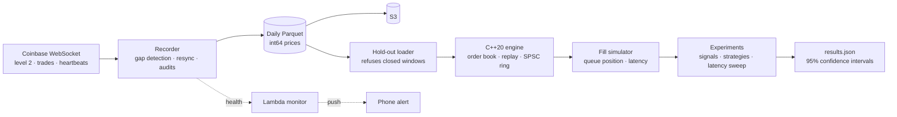

<div align="center">

# Touchstone

**A queue-aware market-making backtester built on a live, self-recorded Coinbase order book.**

*How much does a naive backtest lie? Touchstone records the book, replays it at full fidelity,<br/>
and measures the gap between "the price touched my quote" and "my order actually filled."*

<br/>


[Highlights](#highlights) · [Architecture](#architecture) · [Results](#results) · [Hold-out](#development-data-and-the-held-out-windows) · [Limitations](#limitations) · [Recorder](#recorder)

</div>

---

## Highlights

- **Live data capture, around the clock.** A recorder on AWS streams Coinbase's level-2 book and trades for BTC, ETH, ZEC and NEAR, detects every sequence gap, resyncs from a fresh snapshot, and writes exact integer-priced Parquet.
- **A book you can trust.** Every 15 minutes an independent snapshot audits the replayed book. **754 of 754 audits matched** on the first pass.
- **A C++20 engine.** A cache-friendly order book that stores levels near the touch in a flat array indexed by price tick, finds the best price through a three-level bitmap, and keeps far-away levels in an ordered map. Around it sit a replay engine and a lock-free single-producer, single-consumer ring buffer, exposed to Python through pybind11. Replay is checked to give an identical top of book to a `std::map` book after every message, and runs about **4–5× faster** than it on recorded data.
- **Realistic fills.** A simulator that models queue position, cancellations ahead of the order, network latency, cancel-versus-fill races and post-only rejection.
- **Research without leakage.** Purged walk-forward signal selection, and held-out windows that the data loader itself refuses to open early. Each held-out window can be evaluated only once.
- **Production operations on a small budget.** Per-minute health checks in Lambda, phone alerts within 10 minutes of a stall, a daily report, and a budget action that stops the server automatically. Expected total cloud cost is about $20.

### First-pass findings

From development data recorded on 2026-11-06 to 2026-11-09. Final numbers, on all development days and on the held-out window, are filled in on 2026-11-15.

| Finding | First pass |
| --- | --- |
| Filled volume claimed by a touch-fill backtest, against the queue-and-latency model | **≈ 4.2×** (95% CI 3.1× to 5.9×) |
| Book audits matched exactly | **754 / 754** |
| Events recorded (BTC-USD and ETH-USD, four days) | **142.6 M** |
| Best short-horizon signal | **Queue imbalance**, rank IC 0.11 at 100 ms, 0.18 at 1 s, 0.13 at 10 s |
| Latency at which the market-making edge disappears | **0 ms**: no strategy tested was profitable after realistic fills, even with zero latency |
| Replay throughput and ring-buffer latency | Pending the clean benchmark on an idle machine |

## Architecture



| Layer | Where | Built with |
| --- | --- | --- |
| Recorder | `src/touchstone/recorder/` | Python asyncio, `websockets`, Polars, Parquet |
| Engine | `engine/include/touchstone/` | C++20, pybind11, scikit-build-core, CMake |
| Simulation and research | `src/touchstone/simulation.py`, `signals.py`, `experiments/` | NumPy, Polars, bootstrap confidence intervals |
| Operations | `scripts/` | EC2 (Graviton, arm64), S3, Lambda, EventBridge, Systems Manager, AWS Budgets, systemd, Docker, ntfy |

## Milestones

| | Milestone | Status |
| --- | --- | --- |
| 1 | Recorder | ✅ Done; recorded on AWS from 2026-11-06 to 2026-11-15 |
| 2 | C++ order book, replay engine, ring buffer | ✅ Done |
| 3 | Queue estimator, latency model, fill simulator | ✅ Done |
| 4 | Signal study | ✅ Done |
| 5 | Strategy ladder, P&L attribution, latency sweep | ✅ Done; held-out evaluation on 2026-11-12 to 2026-11-14 |

## Quick start

Requires [uv](https://docs.astral.sh/uv/), a C++20 compiler, and Docker to run the recorder as a service.

```bash
make test        # run the test suite
make reproduce   # rebuild every result in the repository
make record      # record to ./data in the foreground
make docker-up   # record to ./data in a container that restarts on failure
make docker-logs
make docker-down
```

## Results

`make reproduce` runs the tests and then every experiment on the recorded days in `data-server/` (fetch them with `make pull-data`), writing everything to `results/results.json`. Its `headline` section holds the numbers below, each as a value with a 95% confidence interval. The other sections hold every variant and parameter tried, and the per-day figures behind each number.

| Number | What it measures |
| --- | --- |
| `replay_events_per_s` | Recorded rows replayed per second by the C++ engine on the flat, tick-indexed book, reading the top of the book after every message. The same replay on a `std::map` book, run in alternation, and a plain Python version kept sorted with `SortedDict` are in the `engine` section for comparison. |
| `ring_buffer_latency_ns` | p50, p99 and p99.9 from a row's push by the producer thread to its application to the book by the consumer, through the lock-free ring buffer, at a steady 200,000 rows a second |
| `total_events_recorded` | Book updates and trades on the days used, an exact count |
| `touch_fill_overstatement_pct` | How much a touch-fill backtest overstates P&L and fill rate, measured as filled volume, against the queue-and-latency model with `fast_trader` round trips |
| Fees | P&L is reported before fees and at a maker fee of 50 bps, and of 40 bps, of traded notional. 50 bps is the US entry-tier maker fee reported after a change on 2026-09-16; your own order preview shows the rate that applies. |
| `edge_disappears_latency_ms` | For each strategy, the smallest latency in the sweep at which mean P&L stops being positive. Zero means no edge even with no latency. |
| `best_signal_ic_by_horizon` | Out-of-sample information coefficient of the best signal at 100 ms, 1 s and 10 s, chosen by walk-forward on earlier days only |

The experiments use whole days recorded on the server before 2026-11-12. Speed and latency depend on the machine and on what else it is running: the results record the load average, and they should be rerun on an otherwise idle machine.

## Development data and the held-out window

| Window | Dates (UTC) | Products | Use |
| --- | --- | --- | --- |
| Development | Everything before 2026-11-12 00:00 | All | All research and every choice of signal and parameters |
| Held out | 2026-11-12 00:00 to 2026-11-15 00:00 | BTC-USD, ETH-USD | Run once, with everything fitted on development data |

The window is enforced in code. `touchstone.data.load` is how research code reads recordings. It refuses any range that reaches past the development data, rather than quietly cutting it short. `final=True` (`--final`) opens the held-out window, and nothing after it is ever read.

```bash
uv run python -m touchstone.data summary BTC-USD                      # development data only
uv run python -m touchstone.data summary BTC-USD --end 2026-11-13     # refused
make holdout-final      # once, after the 2026-11-15 sync
```

Files from closed windows are not even opened, and rows are filtered on all three clocks, so clock skew cannot let a later row through. A test fails if any module outside the recorder reads recordings around the loader. The held-out evaluation writes its section of the results file once, and refuses to run again, so the window cannot be looked at repeatedly until something looks good. The recorder's own `verify` can read any day, because it reports integrity counts and no prices.

**The window was moved once, before any of it was used.** It was first planned for 2026-11-15 to 2026-11-19, with a second check in December. On 2026-11-12 at 03:30 UTC it was moved to 2026-11-12 to 2026-11-14 so the project could finish sooner, and the December check was dropped. This was allowed only because no result had been computed on any of those days. At the time of the move, 2026-11-13 and 2026-11-14 had not happened yet and 2026-11-12 was three and a half hours old. No recording from 2026-11-11 onward had been copied off the server, and the results file used only 2026-11-06 to 2026-11-09. The server's automatic daily summary counts events and gaps on every day, including these, but reads no prices.

ZEC-USD and NEAR-USD were added to the recorder on 2026-11-11, to show how the edge depends on spread width. Their only development data is the part of that day after they were added, less than a day, so their results are development-only, too thin to fit a strategy on, and not part of the held-out evaluation.

## Limitations

- **The book is conflated at 50 ms.** Coinbase's public level-2 feed sends a batch about every 50 ms, with one row per changed level holding its final size and a single event time. Changes inside a batch cannot be seen, and an order added and filled within one batch never appears. So the queue estimator sees net changes at each level: trades are visible with microsecond timestamps, but cancellations can only be inferred as the drop in size not explained by trades, and additions in the same batch can hide them. For the same reason, the latency sweep cannot resolve book changes finer than about 50 ms, so differences between very small delays say little. Measuring the resulting error needs Coinbase's authenticated full channel.
- **Latency samples are not order entry.** Round trips are WebSocket pings to the market-data endpoint from wherever the recorder ran. They measure the network, not the path through order entry and the matching engine. See [Latency profiles](#latency-profiles).
- **The book check allows for the straddling batch.** An audit snapshot taken between two book messages may already contain part of the later one. The replayed book must match it exactly except at levels that message touches, and any other difference fails the check.
- **The fill model is an estimate.** Our orders are not in the recorded book, so queue position is inferred: trades at our price use up the queue ahead first, and a configurable share of unexplained size decreases counts as cancellations ahead of us. Results are reported with that share at 0, 0.5 and 1.
- **Recordings have outages.** Connections drop from time to time, and the book cannot be rebuilt across a break, so each one starts a new session. The trade snapshot on reconnect usually fills short breaks, and `verify` counts any trades still missing.

## Latency profiles

Measured round trips depend on where they were measured, so they are kept as two labelled profiles, and the latency sweep uses both:

| Profile | Source |
| --- | --- |
| `fast_trader` | The always-on AWS server, labelled `fast_trader (us-east-2)` |
| `home` | A Mac on a home connection, saved when the recorder moved off it, about 37 ms at the median |

`touchstone.latency` loads them, and `uv run python -m touchstone.latency summary` shows them.

## Recorder

The recorder subscribes to the `level2`, `market_trades`, and `heartbeats` channels of Coinbase's [Advanced Trade WebSocket feed](https://docs.cdp.coinbase.com/coinbase-app/advanced-trade-apis/websocket/websocket-overview), which is public and needs no credentials. It writes one Parquet file per product per day.

### Keeping the book correct

The output's central guarantee is that replaying any recorded session reproduces the exchange's book exactly. A lost message that went unnoticed would corrupt every later price, so:

- **Gap detection.** `sequence_num` is per connection and rises by one across all channels, so each product gets its own connection and any jump counts as a loss.
- **Resync from snapshots.** A gap only says that something was lost, not what. The recorder discards the session without writing the message that exposed the gap, reconnects, and starts again from a fresh snapshot.
- **Treating doubt as loss.** An unreadable message, a server error, a silent socket, a book that stops updating while heartbeats continue, or a missing snapshot all force a resync.
- **Self-contained days.** The session is restarted at midnight UTC, so each daily file starts with a real exchange snapshot.

### Audit snapshots

Every 15 minutes a second connection fetches a snapshot and records it as `audit_snapshot` without disturbing the main session. These give the replay engine independent checkpoints to verify the rebuilt book against.

An audit's time often falls between two stream batches, and the snapshot may already include part of the later batch. So a rebuilt book is compared with an audit like this: applying every batch up to the audit's time must match it exactly, except at levels touched by the next batch. On the live feed, all 22 audits checked held to this rule, at about 40,000 levels for BTC-USD and 19,000 for ETH-USD, and the 11 landing exactly on a batch time matched on every level.

### Files

```text
data/
  BTC-USD/2026-11-04.parquet                    one file per product per finished day
  .spool/BTC-USD/2026-11-05/part-00000001.parquet   rows for the current day
  health/2026-11-05.jsonl                       health log
  status.json                                   current state, read by the container health check
```

A Parquet file is unreadable until its footer is written, so holding a daily file open would risk the whole day on a crash. Rows are written instead as complete part files every 30 seconds and merged once the day is over, which limits a crash to the last 30 seconds of buffered rows. The merge is atomic, and recovery on restart handles a crash at any step. `touchstone.recorder.storage.read_day` reads a day whether or not it has been merged.

### Schema

Each row is one changed book level or one trade.

| Column | Type | Meaning |
| --- | --- | --- |
| `local_ts_ns` | Int64 | Local wall clock when the message was received |
| `server_ts_ns` | Int64 | When Coinbase's WebSocket server sent the message |
| `exchange_ts_ns` | Int64 | The matching engine's time for this level change or trade |
| `session` | Int64 | Identifies one connection; its value is the time the connection opened |
| `seq` | Int64 | `sequence_num` of the message, unique within a session |
| `event` | Enum | See below |
| `side` | Enum | `bid` or `ask`. For trades, the side of the resting (maker) order |
| `price_e8` | Int64 | Price multiplied by 1e8, which keeps it exact |
| `size_e8` | Int64 | New absolute size at the level, or traded size, multiplied by 1e8. Zero removes a level |
| `trade_id` | Int64 | Trades only |

| `event` | Meaning |
| --- | --- |
| `snapshot` | The full book at the start of a session. Replay resets its book here |
| `update` | A change to one level |
| `trade` | A trade Coinbase labelled as an update |
| `trade_snapshot` | A trade Coinbase labelled as a snapshot. These are the last 100 trades on subscribing, which can predate the session, but also occasional batches of new trades in mid-session that are delivered nowhere else |
| `audit_snapshot` | An independent book snapshot from a separate connection. Not part of the replay stream |

Rows are in arrival order. To replay, take one `session` at a time and read `snapshot` and `update` rows in file order.

### Things to know when reading the data

- **Use both trade labels.** Filtering on `event == "trade"` silently loses real trades. Take `trade` and `trade_snapshot` together. Repeats are already removed, and trade ids rise by one per product, so `verify` can count any that are missing.
- **Sort trades by `exchange_ts_ns`.** Coinbase lists each batch newest first.
- **Keep what was known separate from what happened.** Trades are batched over 250 ms, so a trade's `local_ts_ns` can trail its `exchange_ts_ns` by that much. Anything simulating what a strategy could have known at a given moment has to use the local time, or it will see trades before they could have arrived.
- **The book is conflated at 50 ms.** See [Limitations](#limitations).

### Health log

`health/YYYY-MM-DD.jsonl` holds one JSON object per line. The events are `start`, `stop`, `fatal`, `connected`, `synced`, `gap`, `out_of_order`, `resync` (with its reason), `audit`, `audit_failed`, `compacted`, `compaction_failed`, `stats`, `low_disk`, and `rtt`. `rtt` records WebSocket ping round trips to the exchange, which the latency model samples from.

### Commands

```bash
uv run python -m touchstone.recorder run --data-dir data
uv run python -m touchstone.recorder verify BTC-USD 2026-11-04 --data-dir data
uv run python -m touchstone.recorder healthcheck --data-dir data
uv run python -m touchstone.recorder compact --data-dir data
uv run python -m touchstone.recorder report --data-dir data
```

`verify` checks a recorded day for the invariants replay depends on and exits non-zero if any fail. It loads the whole day into memory, about 4 GB for a full day of BTC-USD, so run it on a copy rather than on a small server. `report` summarizes the health log: resyncs by reason, gaps, midnight rollovers, merges, and round trips.

### Crash restarts

`docker kill` does not test a crash. Docker treats it as a deliberate stop, so a `restart: unless-stopped` container stays down afterwards. A real crash, tested by sending `SIGKILL` to the process from outside the container, restarts immediately, and everything flushed before it stays readable. On the server, systemd supervises the container instead, so even `docker kill` restarts it.

### Running on AWS

`scripts/deploy.sh` needs Docker and the AWS CLI with working credentials, and is safe to run again. It creates:

- **Where:** `us-east-2`, the only region where the project account allows regional services.
- **An instance:** `t4g.small`, arm64 Amazon Linux 2023, with a 50 GB encrypted gp3 disk. It has no inbound ports and no SSH key, and is managed through AWS Systems Manager. Termination protection is on, and the disk outlives the instance, so recordings are hard to lose by accident.
- **A private S3 bucket:** public access is blocked and versioning is on. At 00:30 UTC each day the server copies merged daily files and health logs there. Its role can add objects but cannot delete them.
- **A phone alert through ntfy:** if a product has no data written for 10 minutes, a push goes to a private topic, repeated hourly until it recovers. The server only reports its last write time to S3, and the check runs in AWS Lambda, so a dead server raises the alert too.
- **Cost guards:** a yearly $100 budget named `touchstone`, counted before credits, emails alerts at $25, $50 and $80 of actual spend and at $80 forecast. At $90 a budget action stops the instance automatically. Stopping, not terminating, keeps the disk and recordings. Set `BUDGET_EMAIL` in `deploy.env`.
- **A daily push at 01:00 UTC:** yesterday's event counts, gaps, reconnects, and AWS spend so far. It crosses the server's daily job, S3, Lambda and ntfy, so if it does not arrive, one of them is broken, including the alert path itself.

```bash
make deploy      # create or update everything
make report      # server status, health summary, and verify on finished days from S3
make pull-data   # copy finished recordings from S3 to data-server/ on this machine
```

To stop recording temporarily, run `sudo systemctl stop touchstone-recorder` on the server, because `docker stop` alone is restarted. `aws ssm start-session` gives a shell.

### Ending the recording

**Run `make teardown` on or after 2026-11-15, once the held-out days are copied.** Charges continue until it is run. It refuses to run before 2026-11-15 00:00 UTC, when the held-out window closes, and asks for confirmation.

It stops the recorder, merges and syncs the last files, and confirms that every file on the server is in S3 at the same size. Only then does it delete the instance, its disk, the alert function and the budget's stop action. If anything does not match, nothing is deleted. The S3 bucket is kept, along with the budget's alert emails, the IAM roles and the security group, which cost nothing. `make teardown-check` rehearses the checks and permissions without changing anything.

### Testing

The tests run the real recorder over a real WebSocket against `tests/fake_feed.py`, which speaks the same protocol, misbehaves on demand, and keeps the true book after every step. Its faults include dropped messages on any channel, aborted and silent connections, garbage, replayed messages, refused connections, and oversized snapshots. The main check replays every recorded session and compares the book with the truth after every message, including under a seeded storm of random faults. Other tests kill the recorder with `SIGKILL` and crash the daily merge at each step.
